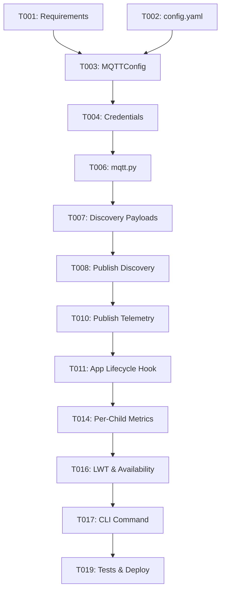

# Tasks: Home Assistant MQTT Discovery & Alerting Integration

**Input**: Design documents from `/specs/002-home-assistant-mqtt/`
**Prerequisites**: plan.md, spec.md, research.md, data-model.md, contracts/

## Format: `[ID] [P?] [Story] Description`
- **[P]**: Can run in parallel (different files, no dependencies)
- **[Story]**: Which user story this task belongs to (US1, US2, US3, US4)

---

## Phase 1: Setup (Shared Infrastructure)

**Purpose**: Dependency installation and baseline requirements

- [ ] T001 Add `paho-mqtt>=2.0.0` to `requirements.txt` and install into development `.venv`
- [ ] T002 Update `config.yaml` with sample `mqtt` section (default `enabled: false`)

---

## Phase 2: Foundational (Blocking Prerequisites)

**Purpose**: Core configuration models and secure credential loading

- [ ] T003 [P] Implement `MQTTConfig` dataclass in `storypark_scraper/config.py` with defaults (`host`, `port`, `username`, `password`, `tls`, `discovery_prefix`, `topic_prefix`, `retain`, `timeout_seconds`)
- [ ] T004 Add MQTT password lookup support in `storypark_scraper/credentials.py` (supporting Windows Credential Manager / DPAPI target `storypark-scraper-mqtt` and `SP_MQTT_PASSWORD` environment variable)

**Checkpoint**: Foundation ready - MQTT configuration and credentials can be loaded.

---

## Phase 3: User Story 1 - Home Assistant Automatic Entity Discovery (Priority: P1) 🎯 MVP

**Goal**: Automatically publish Home Assistant MQTT Discovery JSON payloads for sensors and binary sensors so Home Assistant registers the device without manual YAML configuration.

### Tests for User Story 1
- [ ] T005 [P] [US1] Unit test Home Assistant MQTT Discovery JSON schema generation in `tests/test_mqtt.py`

### Implementation for User Story 1
- [ ] T006 [US1] Create `storypark_scraper/mqtt.py` with `HomeAssistantMQTTPublisher` class
- [ ] T007 [US1] Implement `build_discovery_payloads(config, child_names)` generating discovery configurations for:
  - `sensor.storypark_status`
  - `sensor.storypark_last_run`
  - `sensor.storypark_last_run_duration`
  - `sensor.storypark_stories_total`
  - `sensor.storypark_photos_total`
  - `binary_sensor.storypark_problem`
- [ ] T008 [US1] Implement `publish_discovery(client, config, child_names)` to publish discovery configs with `retain=True`

**Checkpoint**: User Story 1 complete - Home Assistant discovers the device and creates all entities upon MQTT connection.

---

## Phase 4: User Story 2 - Failure & Problem Alerting (Priority: P1)

**Goal**: Expose a `binary_sensor.storypark_problem` entity that transitions to `ON` if a run crashes, fails, or encounters an unhandled error, and resets to `OFF` on success.

### Tests for User Story 2
- [ ] T009 [P] [US2] Unit test telemetry payload generation for success and failure states in `tests/test_mqtt.py`

### Implementation for User Story 2
- [ ] T010 [US2] Implement `publish_telemetry(client, config, telemetry_payload)` in `storypark_scraper/mqtt.py`
- [ ] T011 [US2] Hook MQTT publisher into `StoryparkApplication.run()` in `storypark_scraper/app.py`:
  - On run start: publish `status: "running"`, `problem: "OFF"`
  - On run completion: publish `status: "success"`, `problem: "OFF"`, duration, stories processed
  - On run exception/failure: publish `status: "failed"`, `problem: "ON"`, error details in `storypark/error`
- [ ] T012 [US2] Ensure all MQTT publish calls are non-blocking / safe (catch exceptions so scraper never halts if broker drops)

**Checkpoint**: User Story 2 complete - Failure alerts trigger in Home Assistant immediately when a scrape fails.

---

## Phase 5: User Story 3 - Per-Child Story and Photo Tallies (Priority: P2)

**Goal**: Expose child-specific sensors in Home Assistant for Sam and Lyra (total stories, total photos, latest story title).

### Tests for User Story 3
- [ ] T013 [P] [US3] Unit test per-child metrics extraction and MQTT topic generation in `tests/test_mqtt.py`

### Implementation for User Story 3
- [ ] T014 [US3] In `storypark_scraper/mqtt.py`, dynamically generate discovery topics for configured children (e.g. `sensor.storypark_sam_photos`, `sensor.storypark_lyra_photos`)
- [ ] T015 [US3] Extract per-child cumulative statistics from SQLite `state.sqlite` and include in the state telemetry JSON payload

**Checkpoint**: User Story 3 complete - Per-child counters display in Home Assistant.

---

## Phase 6: User Story 4 - Availability, LWT & CLI Testing (Priority: P3)

**Goal**: Implement MQTT availability with Last Will and Testament and a standalone CLI command for testing.

### Implementation for User Story 4
- [ ] T016 [US4] Configure MQTT client Last Will and Testament (LWT) topic `<topic_prefix>/availability` with payload `offline` and publish `online` upon connection
- [ ] T017 [US4] Add `mqtt-publish` command to `storypark_scraper/cli.py` to allow manual testing and verification from terminal
- [ ] T018 [US4] Add optional periodic MQTT status ping in `storypark_scraper/webserver.py`

**Checkpoint**: User Story 4 complete - Offline detection and manual CLI verification available.

---

## Phase 7: Polish & Documentation

- [ ] T019 [P] Run full test suite (`python -m unittest discover -s tests`) and verify 100% pass rate
- [ ] T020 [P] Update `readme.md` with Home Assistant MQTT configuration guide and example automation
- [ ] T021 Deploy and verify on production VM (`\\main-pc\VMs\storyparkScraper`)

---

## Dependencies & Execution Strategy

**MVP Delivery**: Phases 1 through 4 (T001 - T012) deliver a fully operational Home Assistant MQTT integration with auto-discovery and failure alerts.
